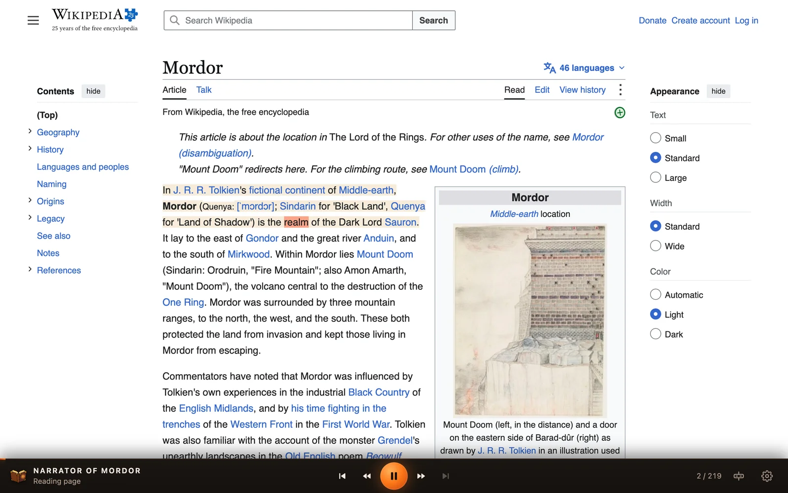
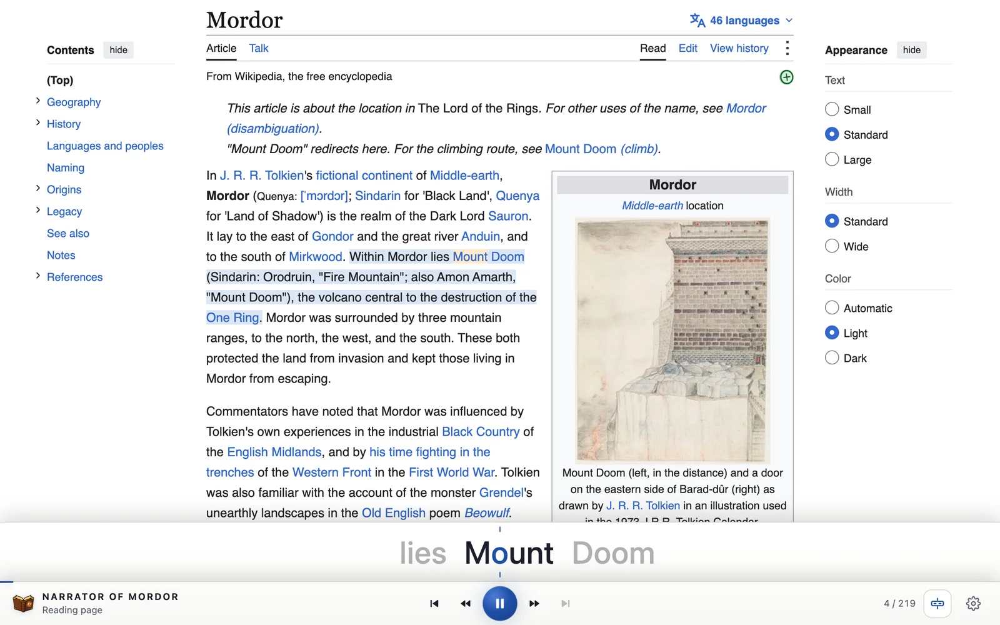
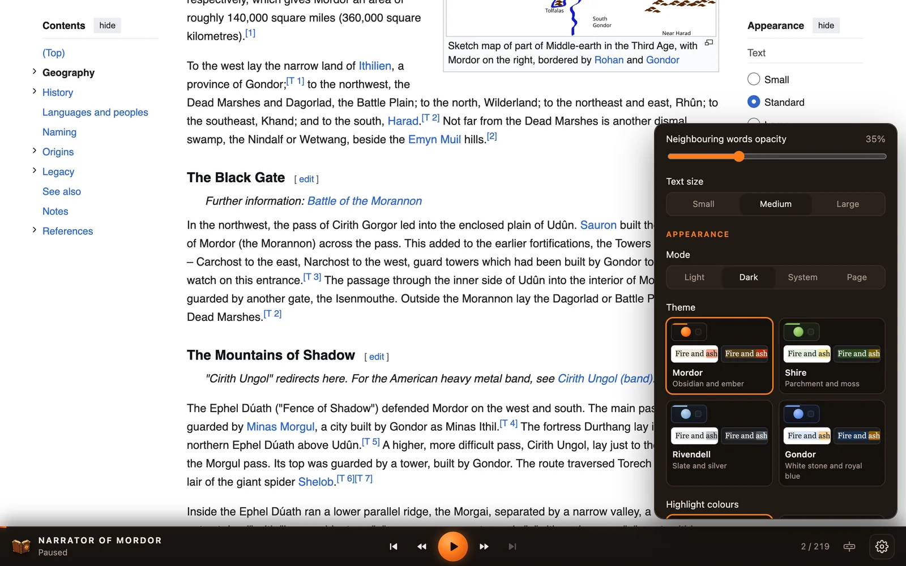
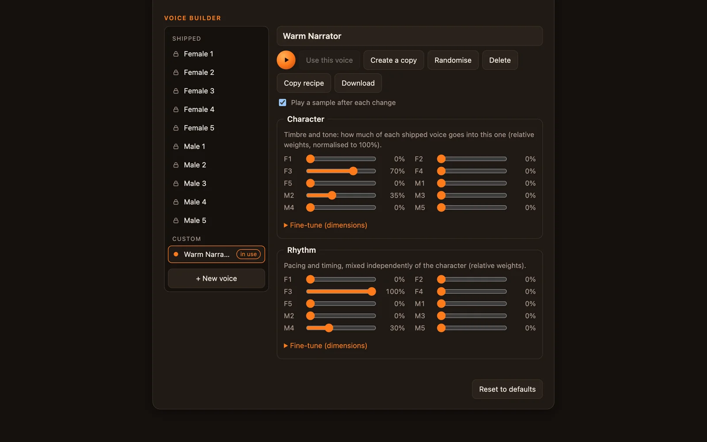

<p align="center">
  
</p>

# Narrator of Mordor

Narrator of Mordor is a Chrome extension that reads web pages aloud. Open its bar on any
page, press play and it narrates the article — or just the text you selected — while
highlighting each sentence and word as it is spoken. Speech is generated locally by
open-weight text-to-speech models running in your browser: nothing is sent to a server,
and there are no accounts or API keys. Use it to listen to long articles, to follow
along while reading, or to speed-read.



## TTS

Text-to-speech runs in a hidden extension page (an offscreen document) on WebGPU when
available, with a CPU (WebAssembly) fallback. Each engine is a module with its own voices
and settings, configurable on the extension's options page.

| Engine | Model | Languages | Voices | Word timing |
| --- | --- | --- | --- | --- |
| **Kokoro** | Kokoro-82M v1.0 (timestamped ONNX export, fp32, ~325 MB), Apache-2.0 | English (US, UK) | 27 | Exact, from the model's phoneme durations |
| **Supertonic** | Supertonic 3 (~99M parameters, ONNX fp32, ~380 MB, 44.1 kHz), Open RAIL-M | 31 languages, one model for all | 10 shipped + custom voices | From the model's text-to-speech attention (±70 ms) |

Supertonic supports Arabic, Bulgarian, Croatian, Czech, Danish, Dutch, English, Estonian,
Finnish, French, German, Greek, Hindi, Hungarian, Indonesian, Italian, Japanese, Korean,
Latvian, Lithuanian, Polish, Portuguese, Romanian, Russian, Slovak, Slovenian, Spanish,
Swedish, Turkish, Ukrainian and Vietnamese. Every Supertonic voice speaks every language;
by default it follows the page's language.

## Features

- **Reading:** the whole page, the detected main article, or the current selection;
  sentences, words and paragraphs are detected automatically from the page
- **Highlighting:** the current sentence and word, in colours derived from the site's own
  background so text stays readable
- **Controls:** play/pause, back to paragraph start, rewind, next sentence, next
  paragraph, and a draggable progress bar
- **Speed:** 0.5× to 4× with a words-per-minute estimate; volume and auto-scroll
- **Natural narration:** several sentences per request for better intonation, pauses
  between paragraphs and after headings
- **Voices:** voice choice per engine, voice previews, and a Voice Builder for creating
  and exporting custom Supertonic voices
- **Speed reading (RSVP):** an optional bar showing the current word with a fixed focus
  letter, optionally with neighbouring words, with or without narration
- **Appearance:** four colour themes (Mordor, Shire, Rivendell, Gondor) in light and
  dark, and highlight colour schemes with adjustable intensity
- **Options page:** enable engines, set engine parameters (device, language, quality,
  request size) and manage voices
- **Convenience:** per-tab toggle that survives reloads and navigation, keyboard shortcut
  **Alt+Shift+N**, and the opening of a page prepared in advance so playback starts
  instantly
- **Feedback:** a button in the bar (and links on the options page) opens a pre-filled
  GitHub issue for a bug report or feature suggestion

<table>
  <tr>
    <td width="50%"></td>
    <td width="50%"></td>
  </tr>
  <tr>
    <td align="center"><em>Speed reading (RSVP) in the Gondor light theme</em></td>
    <td align="center"><em>Settings menu with theme previews</em></td>
  </tr>
</table>


<p align="center"><em>Narration Options: Supertonic's Voice Builder</em></p>

## Build and install

```bash
git clone https://github.com/chunky-bits/narrator-of-mordor.git
cd narrator-of-mordor
npm install
npm run assets   # downloads Kokoro (~340 MB) and Supertonic (~380 MB) into public/models
                 # (patching Supertonic for word timing needs Python with `pip install onnx`)
npm run build    # outputs the unpacked extension to dist/
```

Then open `chrome://extensions`, enable **Developer mode**, click **Load unpacked**
and choose the `dist/` folder. This development build includes the models. Click the toolbar icon (or press Alt+Shift+N) to show
the bar on a page. The shortcut can be changed at `chrome://extensions/shortcuts`.

## Releases

The Chrome Web Store package leaves the models out (about 6 MB instead of 730 MB). Each
engine's files are downloaded the first time it is used, with progress in the bar,
checked against their SHA-256 and kept in the browser's Cache API
(`src/engines/model-store.ts`). They come from the
[`models-v1`](https://github.com/chunky-bits/narrator-of-mordor/releases/tag/models-v1)
release of this repository.

```bash
npm run release:models -- --upload  # hash public/models into src/engines/model-files.json and upload the release assets (needs gh)
npm run package                     # build and zip dist/ without models into release/
```

A changed model file needs a new release tag (`TAG` in `scripts/release-models.mjs`):
the extension caches files per tag and removes older ones. To test a package against
another location, build with `VITE_MODELS_URL=<url ending in />`.

## How it works

| Part | File | Role |
| --- | --- | --- |
| Service worker | `src/background/background.ts` | Per-tab on/off state, toolbar/shortcut, offscreen lifetime |
| Offscreen document | `src/offscreen/`, `src/engines/host.ts` | Runs the TTS engine modules |
| Engine modules | `src/engines/` | One folder per engine (Kokoro, Supertonic), see below |
| Options page | `options.html`, `src/options/` | Engine settings: enable, parameters, voice previews |
| Content script | `src/content/` | Bar UI, text extraction, playback, highlighting |

**Engine modules.** Each TTS engine lives in `src/engines/<id>/` as two halves:
`meta.ts` (name, voices, configurable parameters — imported by the bar and the options
page) and `engine.ts` (the synthesiser, loaded lazily in the offscreen document only).
Both are registered in `src/engines/registry.ts`. The options page
(`chrome://extensions` → Details → Extension options, or "Engine settings…" in the
bar's menu) renders a form from each module's parameter specs; the values are stored in
`chrome.storage.sync` and sent along with every synthesis request, since the offscreen
document cannot read storage. Changing a parameter listed in `reloadParams` (such as
Kokoro's device) reloads that engine on its next request. Voice ids are
`<engine>:<voice>`, e.g. `kokoro:af_heart`.

To add an engine: create `src/engines/<id>/meta.ts` exporting an `EngineMeta` and
`src/engines/<id>/engine.ts` exporting an `EngineImpl` (see `src/engines/types.ts`),
then add both to `registry.ts`. Its voices appear in the bar and its settings on the
options page automatically.

**Exact word timing.** The model export used
([`onnx-community/Kokoro-82M-v1.0-ONNX-timestamped`](https://huggingface.co/onnx-community/Kokoro-82M-v1.0-ONNX-timestamped))
returns the predicted duration of every phoneme token next to the audio. Each word is
phonemised separately, so the engine knows exactly which tokens belong to which word
and converts the durations into word start/end times. The page plays the audio in its
own `AudioContext` and highlights from that audio clock.

**Natural rhythm.** Because words are phonemised one by one (needed for exact
timing), espeak would give every word full stress and its dictionary form ("for a" →
"for AY"). Common function words ("the, a, to, for, of, and…") are therefore replaced
by their unstressed running-speech forms, as in the speech Kokoro was trained on.

**Chunked synthesis.** Several sentences per request give the model context for more
natural intonation, so text is synthesised in chunks of whole sentences within a
paragraph: up to 500 tokens on WebGPU, 250 on the WASM fallback. After a start or seek
the first chunk is a single sentence (sound within ~1 s), and each following chunk may
grow to 4× (WebGPU) / 1.6× (WASM) the previous one, so it is ready before the previous
one ends. A chunk plays as one continuous audio source; the current sentence is derived
from the word timings, so seeking within a generated chunk is instant. Paragraph ends
get a 0.4 s pause and headings 0.6 s. When the bar opens, the first two chunks of the
page are prepared in the background.

**Supertonic word timing.** Supertonic predicts one duration per request, not per
character, so its timing comes from the model's text-to-speech cross-attention instead:
`scripts/patch-supertonic.py` exposes two attention maps of the vector estimator, a
monotonic path through them gives each character's time (resolution ~70 ms per latent
frame), word starts falling inside a pause are moved to the end of the pause, and words
squashed together after a silence are spread by length. Its language follows the page
(`<html lang>`) by default.

**Voice Builder.** Supertonic voices are style parameter sets for one shared model
(character: 50×256 values, rhythm: 8×16). The options page has a Voice Builder in which
custom voices are recipes built from the 10 shipped voices: a mix of them plus offsets
along their 9 principal directions, separately for character and rhythm
(`src/engines/supertonic/voices.ts`). Shipped voices are read-only; custom voices can be
created at random, copied, renamed, randomised, deleted, previewed and used. "Copy
recipe" puts a compact recipe on the clipboard; "Download" saves a full voice file in
Supertonic's `voice_styles` format with the recipe in its metadata. Recipes are stored in
`chrome.storage.sync` and sent with each synthesis request.

**Feedback** goes through GitHub's issue forms (`.github/ISSUE_TEMPLATE/`). The bar's
feedback button opens a new issue whose fields are pre-filled through the address
(`src/shared/feedback.ts`): extension, browser and OS versions, engine status, voice,
speed and the main settings — never page content. The page's address is added only
when the "Include this page's address" switch is on. The reporter reviews the issue on
GitHub and submits it with their own account, so the extension holds no tokens.

**Highlighting** uses the CSS Custom Highlight API, so the page's DOM is never
modified. Colours are derived from the composited background behind the text:
the sentence gets a lightness shift in the same hue family, the word a different hue
with a stronger shift, both adjusted to keep the site's text colour readable.

## Development

```bash
npm run dev          # Vite dev server; open http://localhost:5173/harness/
npm run typecheck
npm run test:engine  # synthesises a sentence in Node, prints word timings, writes test.wav
npx tsx scripts/make-samples.ts  # renders A/B narration samples into samples/ (open samples/index.html)
```

`/harness/palettes.html` shows every highlight scheme on representative page backgrounds.
The harness page runs the content script and the engine together with a small
stand-in for the `chrome.*` APIs, which is the quickest way to iterate on the UI.

## Licence

GPL-3.0-or-later. The phonemiser bundles eSpeak NG (GPL-3.0). Kokoro model weights
and `kokoro-js` (whose text normalisation is adapted in `src/engines/kokoro/phonemize.ts`)
are Apache-2.0.
